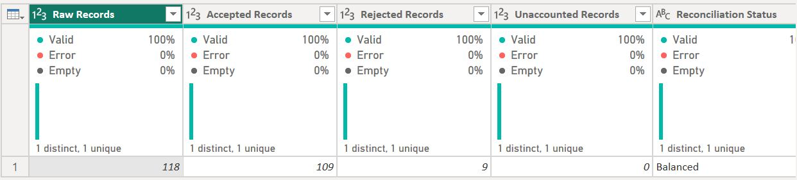
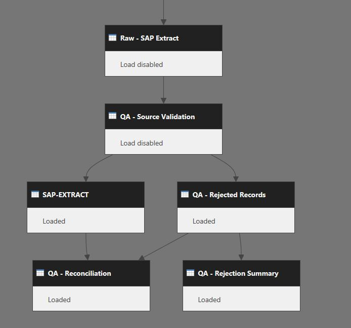

# Power Query Data Quality & ETL Project

**A guided learning project exploring data cleaning, validation, exception management and reconciliation using Microsoft Power Query.**

## Why I created this project

As I've been developing my skills in data analytics, I was introduced to Power Query and became increasingly interested in what happens to data *before* it reaches a dashboard.

How do we know that the records are valid? What happens to the ones that aren't? And how can we be confident that nothing has been lost during cleaning?

What started as a straightforward data-cleaning exercise gradually became a much more detailed exploration of data quality and ETL.

## About the learning process

This was a **guided, hands-on learning project**, developed with support from ChatGPT as a learning and troubleshooting tool.

I worked through the dataset step by step, investigating inconsistencies, applying transformations, testing validation rules and exploring how different queries interact.

As the project developed, I began asking questions that took it beyond the original exercise. Rather than simply removing invalid records, I wanted to understand why they were invalid, preserve them for investigation and make sure every source record was accounted for.

This led me to build separate validation and rejection queries, a rejection summary and an automated reconciliation check.

The project reflects both the technical skills I'm developing and the way I enjoy working with data: understanding the problem, investigating what doesn't look right and finding a structured way to improve it.

## Project objective

To transform a simulated video-game distribution dataset into a cleaner, reporting-ready dataset while preserving rejected records and creating a transparent, auditable data-quality process.

### Reconciliation Results

The reconciliation check confirms that all 118 source records have been accounted for: 109 accepted and 9 rejected, with no unaccounted records.

**Reconciliation status: Balanced**

118 original records = 109 accepted + 9 rejected.

Of the nine rejected records:

- **5** contained invalid Package ID formats.
- **4** were missing Package IDs.

All 118 source records were accounted for.

A balanced reconciliation doesn't necessarily mean the dataset is completely accurate. It confirms that the source records have been accounted for within the accepted and rejected outputs.

## My approach

### 1. Preserving the raw data

I created a separate raw staging query to preserve the original dataset before performing substantive cleaning.

This allows the original values to remain available for investigation and comparison.

### 2. Exploring and profiling the data

I examined the dataset for missing values, inconsistent formatting, inappropriate data types, potential duplicates and unexpected values.

I also explored Power Query's Column Quality, Column Distribution and Column Profile features to understand the structure of the data.

### 3. Creating validation rules

I created a central validation query to check Package IDs and classify records as:

- Valid
- Invalid
- Missing

Rather than maintaining separate validation rules across multiple queries, I linked the cleaned dataset and rejected-records table to the same validation source.

This helps ensure consistent handling of records when new data arrives.

### 4. Separating accepted and rejected records

Instead of simply deleting invalid records, I created a separate query to preserve them for investigation.

Each rejected record was assigned a rejection reason.

I then created a summary table showing the number of records rejected for each reason.

### 5. Cleaning and transforming accepted data

I applied several transformations, including:

- Trimming unwanted whitespace.
- Converting columns to appropriate data types.
- Converting dates using the correct locale.
- Removing currency symbols and converting prices to fixed-decimal values.
- Standardising region codes into descriptive labels.
- Splitting the combined Game field into Game and Console columns.
- Preserving leading zeros in Batch identifiers by storing them as text.
- Creating a calculated Order Value column.
- Checking numeric values, conversion errors and selected calculations.

These transformations helped create a more consistent dataset for reporting and analysis.

### 6. Building an automated reconciliation check

I created a reconciliation query using Power Query M functions to calculate:

- Raw record count.
- Accepted record count.
- Rejected record count.
- Unaccounted record count.
- Reconciliation status.

The reconciliation calculation is:

`Raw Records - Accepted Records - Rejected Records`

A conditional status identifies whether the counts are **Balanced** or show a **Mismatch**.

This provides an additional control to help identify records that may have been unintentionally lost during processing.

### 7. Reviewing the query architecture

One of the most interesting parts of this project was exploring Power Query's Query Dependencies view.

It allowed me to visualise how data flows between queries and distinguish between queries that support transformations and those that produce final reporting outputs.

I disabled loading for intermediate queries that weren't required in the Power BI model, while retaining them as part of the transformation pipeline.

### Query Architecture

**Power Query Dependencies**

The diagram below shows how the raw data flows through validation, cleaning, exception reporting and reconciliation.

### Using the Power Query scripts

I've included the Power Query M scripts used to build the cleaning, validation and reconciliation process.

The original Excel file was stored locally on my computer, so I've replaced the file path in the `Raw-SAP-Extract.pq` script with a placeholder:

`C:\PATH\TO\YOUR\DATA\DIO_practice_book2.xlsx`

To use these scripts with the original source file, this path needs to be replaced with the location where the Excel file is saved on your own computer.

The queries also reference one another, so the original query names need to be retained for the pipeline to work correctly.

I've kept the scripts separate so that anyone interested in the project can explore the transformations, validation rules and reconciliation logic without needing to open a Power BI report.

*Please note that the source Excel file is not currently included in this repository.*

## Tools and skills developed

**Tools**

- Microsoft Power Query
- Power Query M language (Basic level)
- Power BI Desktop (Power Query Editor)
- Microsoft Excel

**Skills**

- Data profiling and exploration
- Data cleaning and transformation
- Data-type management
- Rule-based validation
- Exception management
- Data reconciliation
- ETL pipeline organisation
- Query dependencies and data lineage
- Troubleshooting and quality assurance
- Technical documentation

## Assumptions and limitations

As this is a learning project, some business rules were established for practice rather than confirmed with a data owner.

These include:

- **Package ID:** Identifiers were expected to contain numbers only.
- **Region:** The code `EN` was interpreted as England.
- **Stock Quantity:** This was assumed to represent a quantity suitable for calculating Order Value. That calculation should not be interpreted as revenue without business confirmation.
- **Age Rating:** The meaning and classification system of the supplied ratings would require confirmation.
- **Publisher:** The dataset distinguishes First Party and Third Party but does not identify individual publishing companies.

The project includes Package ID format validation and checks for duplicates in the current dataset, but a comprehensive automated duplicate-rejection process has not yet been developed.

The reconciliation control confirms record accountability, not the accuracy of every individual value.

## Future improvements

As I continue developing my skills, I'd like to expand the project by:

1. **Adding duplicate-detection rules** to identify repeated Package IDs and potential duplicate records automatically.
2. **Introducing validation severity levels** to distinguish between records that must be rejected and records that require review.
3. **Creating a data-quality rules register** to document each rule, its purpose, severity and treatment.
4. **Testing the pipeline with new records** to confirm that valid, invalid, missing and duplicate values are handled correctly during refresh.
5. **Testing changes to the source structure** to understand how the process behaves when columns or formats change.
6. **Developing additional quality metrics** to monitor the proportion of accepted and rejected records over time.

## What I learned

My biggest takeaway was that data cleaning involves much more than correcting formatting or removing errors.

I learned the importance of preserving the original data, understanding why records fail validation, applying consistent rules and checking that every record is accounted for.

I also discovered how useful it is to visualise query dependencies. Seeing the relationships between different stages of the process made the overall ETL architecture much easier to understand.

Most importantly, this project confirmed how much I enjoy investigating data-quality issues and developing structured approaches to resolving them.

What began as a small exercise became an opportunity to explore an area of data analytics that I'd really like to keep developing.

---

*This is a personal, guided learning project using a simulated dataset. It is not affiliated with SAP or any video-game publisher.*
